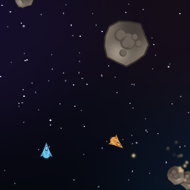
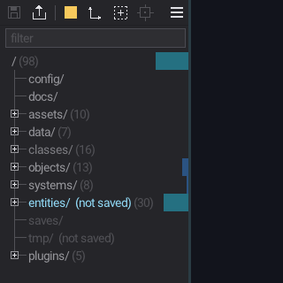
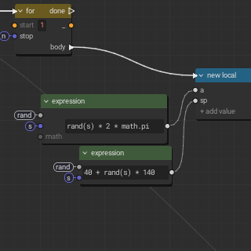
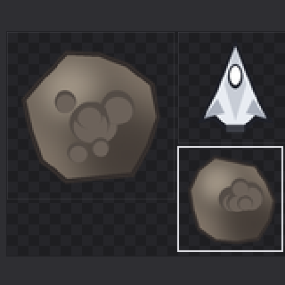

# Replay: how to use it

How to make a game with Replay, from the big picture down to every button.
Read the first two parts once; come back to the later ones when you need them.
In the editor, **F1** (or the menu's **Help**) opens this file; in a plugin's tab, that plugin's own `HELP.md` when it has one.

1. [The big picture](#1-the-big-picture)
2. [Your first game in ten minutes](#2-your-first-game-in-ten-minutes)
3. [The screen](#3-the-screen)
4. [How a game is made](#4-how-a-game-is-made)
5. [Working day to day](#5-working-day-to-day)
6. [Reference](#6-reference)

Kept current by hand: when a feature, a button or a key changes, its
section here changes in the same commit ([FEATURES.md](FEATURES.md) is the detailed
list of what exists; this file is how to use it). Last reviewed 2026-10.

---

## 1. The big picture



- **A game is a tree.** Every thing in it is a *node* with a path
  (`/objects/ship1`). A node holds *components*: plain data (`xform = { x = 0, y = 0 }`)
  or code. On disk a node is a folder and a component is a `.lua` file in it.
- **Systems are code in the tree.** A system is a component holding Lua
  (`systems/ships/system.lua`). Every tick, the systems update the nodes.
- **The game runs while you edit it.** Change a value, a file or a system and
  the running game takes it at once. Broken code keeps the last good version
  running and says where the error is.
- **Time is recorded.** The bottom bar's timeline takes a snapshot of the
  game every half second: scrub back, change something, play on from there.
- **Text is the truth.** The node graph, the property panel and the tree
  are other views of the same source files.
- **Sharing is a folder.** Export puts the game and a renamed copy of the
  editor in a folder; that exe runs just the game.

The loop you'll repeat all day:

```
open a game -> play -> stop / pause -> change it (tree, props, code, graph) -> play -> ... -> save -> export
```

## 2. Your first game in ten minutes

New here? Open **games/tutorial.lua** ("Light the beacon") first: a little
game you finish by using the editor. Its cards say what to do next (Play,
pick the beacon, change its intensity and pulse speed while the game runs,
rewind; the window maximized, the eye; then its own code: its node graph
beside the text, a number changed in either (the other follows), two nodes
wired in the graph, Restart: it runs; L changes its language: English, Spanish, French; it never asks
you to save, so it plays the same every time). Each card is beside the
yellow ring that points at what to use
and the part of the editor to use pulses yellow.

1. **Start the editor** with no arguments (`replay.exe`). The project
   launcher lists the games in `games/`, folders first, then single-file
   games, each alphabetical (not `games/common/`: the script games' shared
   art); click one, or arrows and Enter;
   a gamepad works too). Its last row is **New project**:
   type a name (`letters, digits, _ or -`), Enter. You get
   `games/<name>.lua` (with `games/<name>.png`, its icon: a copy of `play.png`;
   a script that builds the world: a spinning box and a
   title) and the editor opens it, playing.
2. **Look around.** Left: the tree (`/` and its roots) and, below it, the
   properties of what you select. Right: the game, and the code editor
   behind it. Bottom: play controls, the timeline, a Lua console.
3. **Stop** (the square next to Play, bottom left). The view turns to the editor:
   the script is open in a tab.
4. **Change something.** In the script, give the box another colour or a
   faster `spin`, then Ctrl+S. Play: it's there.
5. **Select a node.** Open `objects` in the tree (its `+` box), click `box`:
   its components show in the properties. Drag a number to change it (Shift
   x10, Ctrl x0.1); the game shows it while it runs.
6. **Add a system.** Systems are functions in the script:
   ```lua
   local drift = ecs.system(function()
     return { requires = { "xform", "drift" }, run = function(w, n, dt)
       n.c.xform.x = n.c.xform.x + n.c.drift * dt
       if n.c.xform.x > 200 then n.c.xform.x = -200 end
     end }
   end)
   w:spawn("/systems/drift", { system = drift })
   ```
   and add `drift = 60` to the box's components (`w:spawn("/objects/box", { ..., drift = 60 })`).
   Save, play: the box drifts right and wraps. (A system can't use locals from outside its function: it's
   stored and run on its own.)
7. **Rewind.** Pause, drag along the timeline, Play: the game goes on from
   that moment.
8. **Save** (the disk icon, top left; yellow when there's something to save).
   For a script, edits made in the tree and properties go to
   `<name>.overrides.lua` beside it.
9. **Export** (the box with an arrow, next to Save): pick a folder; it gets
   `<name>.exe`, its DLLs, `runtime/` and the game. Send the folder.

For a bigger game, use a **folder** world instead of a script (see
`games/asteroids/`): one file per component, so the tree, the editor and
version control all see small files.

## 3. The screen



```
+------------------------+------------------------------------------+
| toolbar           [=]  |                                          |
| [filter          ]     |        the game (back layer)             |
| / (62)                 |        + its overlay (selection, gizmos) |
|  config                |                                          |
|  [+] assets (9)        |        the code editor, node graphs,     |
|  [+] data (7)  ...     |        plugin tabs (front layer, see     |
|========================|        through it by the opacity)        |
| props  <node>  Save Undo                                          |
|  component / fields    |                                          |
+------------------------+------------------------------------------+
| > || []  <<  players  network  speed  [ timeline ......... ] > lua |
+--------------------------------------------------------------------+
```

- **The left tab**: the toolbar, the tree's filter, the tree, and the
  properties (the line between them, and the tab's right edge, can be
  dragged; both are remembered; a double-click puts one back where it
  started). Lite's splits too: a double-click sets one half way.
- **The game area**: the game at the back; the editor (lite: code, node
  graphs, plugin tabs) on top. How much of the editor shows is the
  **opacity** button (see [5.1](#51-views-play-pause-stop)).
- **The bottom bar**: time controls, players and network, speed, the
  timeline, and a one-line Lua console.

## 4. How a game is made

### 4.1 The layout of a world

A world (script or folder) that has `/objects`, `/systems` or `/entities`
follows the layout. Its roots, top to bottom in the tree:

| Root | What goes there | Saved? |
|---|---|---|
| `/config` | the project's settings, as components: `window = { w, h, title }` | yes |
| `/docs` | the game's documents: notes, design, plans (`docs/*.md`) | the files themselves |
| `/assets` | the game's files: pictures, materials... (the `assets/` folder) | the files themselves |
| `/data` | rules, state, tables (`/data/rules`, `/data/state`, `/data/lib/<name>` modules) | yes |
| `/classes` | component types: their members, types and start values | yes |
| `/objects` | what's placed in the world: ships, the HUD, the camera... | yes |
| `/systems` | the code: one node per system, run in `/systems`' order | yes |
| `/entities` | what the game spawns while playing (shots, sparks) | never |
| `/saves` | savegames the game wrote (`saves/<name>.sav`) | the files themselves |
| `/tmp` | scratch | never |
| `/plugins` | the editor's plugins (not part of the game) | to their own folders |

Only `/objects` and `/entities` are *live*: drawn, picked, and run through
per-node systems.

### 4.2 Components and what the viewer draws

Any data is a component. A few names are drawn by the editor and the
exported game:

| Component | Example | What it does |
|---|---|---|
| `xform` | `{ x = 0, y = 0, r = 0, s = 1 }` | place, turn (radians), scale (`sx`, `sy` apart), shear (`shear = 0.3`: its top leans right by that much of its height, a slanted look; negative: left; `shear_y`: its right side goes down); children follow their parent; everything it draws follows (text too) |
| `color` | `{ 255, 200, 80, 255 }` | colour; children inherit it |
| `rect` | `{ w = 60, h = 20, fill = true }` | a box, centred |
| `circle` | `{ r = 10, fill = true }` | a circle |
| `lines` / `tris` | `{ x1, y1, x2, y2, ..., loop = true }` | a polyline / filled triangles |
| `text` | `"hello"` or `{ "hello", size = 2 }`; TrueType: `{ "Hello 🙂", font = "sans", size = 24, align = "center", fallback = "/assets/emoji.ttf" }` | text: the 8 x 8 font (`size`: its multiple), or with `font` a TrueType one: `"sans"`, `"sans-bold"`, `"mono"` (built in) or a `.ttf` / `.otf` of `assets/`, `size` in pixels, `align` left / center / right of the node; `width = 200` wraps it to that width (in the node's units; `\n` breaks a line too; the lines aligned in it); `shear = 0.2` slants it (a cursive: the text's own, its node's `xform.shear` slants all it draws); it turns, scales and shears with its node, rendered sharp at the size it shows; `shadow = true` (or its colour) a dark copy under it, to read over anything; `fallback`: a font for the characters the first lacks (emoji: a colour emoji font such as Noto Color Emoji or Twemoji) |
| `sprite` | `{ "..##..", ".#..#.", palette = { ["#"] = { 255, 0, 0 } }, px = 2 }` | ASCII pixel art |
| `image` | `{ "/assets/ship.png", w = 36, h = 36, color = {...}, smooth = false }` | a picture from `assets/`, centred; `src = { x, y, w, h }`: only that part; `{ "/assets/ui.atlas.lua", frame = "ship" }`: a frame of an atlas; `at = "sheet"`: drawn where it is in the whole picture |
| `bullets` | `{ "/assets/spark.png", size = 10, xy = { x1, y1, x2, y2, ... }, s = {...}, rgb = { 0xff6aa0, ... }, a = {...}, o = {...} }` | many small pictures in one batch (bullets, sparks, stars): one per x, y; `s` sizes, `rgb` tints, `a` turns (radians), `o` opacities (0..1), each optional; no picture: soft dots |
| `tilemap` | `{ "/assets/level.tmap", layer = "ground", size = 16 }`, or a layer in place: `{ rows = { "0001..", ... }, tileset = "plugin:tiles.png", tile = 16 }` | a tile map's layer (plugins/tilemap), from the node's top left; a .tmap file is read again when it changes; `plugin:tiles.png`: the tilemap plugin's tileset; rows: two hex digits a cell, `..` none (a map the game made: `w:generate`) |
| `ref` | `"/assets/ship"` | draw that node's subtree here |
| `bounds` | `{ w =, h = }` or `{ r = }` | the shape a right-click picks |
| `hidden` | `true` | don't draw this subtree |
| `layer` | `"fx"` | draw this subtree in that layer (see below) |

**Draw order.** Without layers, the tree's order: `/entities` then
`/objects`, each subtree by rank and name, later drawn over earlier. With a
`layer` component on some nodes (it covers what's under them, unless they
say otherwise), each layer draws in turn, bottom to top, in the order
`/data/layers`' `order` lists (`return { "default", "fx", "hud" }`); layers
it doesn't list come after, by name; a node with no layer is in
`"default"`. Within a layer: the tree's order. A right-click picks what's
drawn last. asteroids puts sparks and shots in `fx` and its HUD in `hud`.

### 4.3 Classes

A class (`/classes/ship`) describes a component: each member has a type,
a start value and maybe a range or options:

```lua
hp   = { type = "int", value = 10, min = 1, max = 20 }   -- a slider
mode = { type = "string", value = "slow", options = { "slow", "fast" } }   -- a drop-down
tint = { type = "color3", value = { 255, 0, 0 } }        -- a swatch
```

A node with a `ship` component gets every member it lacks (dim in the
properties, the class's value) and keeps the ones it sets (a teal bar).
Change a class and the nodes that kept its value follow. Built-in types:
`int number angle string key asset node bool vec2 vec3 vec4 quat rect
color3 color4`.

### 4.4 Systems

A system is a code component named `system` on a node under `/systems`.
Two shapes:

```lua
-- once a tick
return function(w, dt) ... end

-- once a tick per live node that has these components
return { requires = { "xform", "vel" }, run = function(w, n, dt)
  n.c.xform.x = n.c.xform.x + n.c.vel.x * dt
end, on_key = function(w, key, down, player) end }
```

The table form takes more, all optional:

| Field | What it does |
|---|---|
| `filter = { any = { "a", "b" }, none = { "frozen" } }` | besides `requires` (all of them): one of `any`, none of `none` |
| `on_add = function(w, n)` / `on_remove = function(w, n)` | a node enters / leaves the system's list (spawned, removed, a component came or went), before it runs |
| `interval = 0.5` | runs every 0.5 s of game time; dt is the time since its last run |
| `active = false` | kept, not run. Or an `active` component set to false on its node (`/systems/debug`): its props row switches it |
| `on_event = function(w, name, data, player)` | an event (below) |
| `on_editor = function(w, what, data)` | the editor, as you use it (a game that teaches it: games/tutorial.lua): `"start"` (the world (re)loaded), `"playing"` / `"paused"` / `"stopped"` (`data.from`), `"select"` (`data.path`: a node picked), `"edit"` (`data.paths`, `data.keys`: a value changed in the properties), `"seek"` (`data.t`, `data.back`: the timeline moved), `"save"`, `"view"` (`data.view`: `"editor"` / `"mixed"` / `"game"`, the eye), `"picking"` (`data.on`), `"tab"` (`data.tab`: the game's file shown as `"text"`, as its `"graph"`, or `""`), `"code"` (`data.unsaved`, `data.text`: its text changed in the editor, the text as it is now; not saved: Restart, or Play after a pause, runs it), `"cursor"` (`data.line`: its cursor's line), `"window"` (`data.maximized`). `"tab"` is `"both"` with its text and its graph side by side. Paused and stopped too; never in an exported game. `w.editor` has the same (`mode`, `view`, `picking`, `selected`, `tab`, `unsaved`, `line`, `maximized`) to read any time |

- Each system's list of nodes is kept, and worked out again when the tree
  changes: a node spawned by one system is run by the systems after it in
  the same tick; a removed one is skipped at once. A component added by
  hand (`n.c.vel = {...}`) joins the lists at the next change, w:set, or
  twice a second; `w:refresh()` makes it now.
- **Events**: `w:event("boom", { x = 10, y = 20 })` hands a one-shot thing
  (a sound, a burst, "left wins") to `w.on_event` and every system's
  `on_event` at once; online, only the host's count, and every player gets
  them once, in order. asteroids' sparks are made so: an event, and each
  player makes the burst itself.

- The run order is `/systems`' `order` (drag systems in the tree).
- Code runs in a sandbox: math, string, table, utf8 and safe base
  functions; no io, os or load. `dd.*` draws debug shapes.
- `require "space"` loads `/data/lib/space/module.lua`, a module: shared
  helpers. Edit it and the systems using it rebuild.
- A compile error keeps the old version; a run-time error stops that
  system until its source changes. Both show in the log with `file:line`.

The world API a system uses most:

| Call | What it does |
|---|---|
| `w:node(path)` | the node at a path (or nil); `n.c` its components, `n.path`, `n.name` |
| `w:spawn(path, components)` | make (or update) a node, parents as needed |
| `w:remove(path)` | remove it and what's under it |
| `w:select("/entities/rocks/*")` | the nodes matching a pattern (`*`, `**`) |
| `w:children(node)` | its children, in order |
| `w:owns(node)` | does this player decide for it (networked games) |
| `w:event(name, data)` | a one-shot event: every `on_event` gets it (online: from the host, to every player) |
| `w:refresh()` | components added by hand: join the systems' lists now |
| `w:text_size(text [, font, size, width])` | how big a text draws: w, h in pixels (wrapped to `width`: its lines' box; no font: the 8 x 8 one's, `size` its multiple) |
| `w:panic(title [, text])` | the game's own fatal screen, in the error overlay: modal (no keys, mouse or pads reach anything), the game paused, until dismissed (Enter, ESC, Continue); then `w.on_panic_closed(w)` if set. `text`: lines split by `\n`. In an exported game too |
| `w:point_at(name [, note])` | the editor points at a part of itself, a pulsing ring (with a note, "title\nline\nline", a line starting with a tab dim: shown beside it in the editor's font, over the game and the code alike; beside the tree / properties, not over them; no name: at the game area's top right): `"play"` (`"pause"`), `"stop"`, `"rewind"`, `"save"`, `"export"`, `"speed"`, `"players"`, `"menu"`, `"eye"`, `"picking"`, `"timeline"`, `"console"`, `"tree"`, `"props"`, `"game"`, `"flip"` (the icon on the game file's tab: text / node graph); nil: nothing (games/tutorial.lua) |
| `w:savegame(name, t)` / `w:loadgame(name)` | write / read `saves/<name>.sav` |
| `w:asset(name)` | an asset's data (`assets/<name>`, Lua data: a `.tmap`, an `.sfx`...) |
| `w:generate(kind, settings)` | the editor's generators, from a game: `w:generate("dungeon", { seed = 5, rooms = 8 })`, `w:generate("terrain", { seed = 5, island = true })` -> map data (`w`, `h`, `layers` = { { name, rows } }) and what it made (the dungeon's `list`: each room's x, y, w, h, cx, cy in cells). The settings are the `.dungeon` / `.terrain` ones (plugins/<kind>/gen.lua). Draw a layer with `tilemap = { rows = data.layers[1].rows }` |
| `w:sound(name [, volume or opts])` | plays a sound of `assets/` once: `"jump"` (jump.sfx, made with sfxr; else jump.soundgraph, a sound graph) or a `.wav`, `.ogg`, `.mp3`, `.flac` file. `opts`: `{ volume = 1, pan = 0 (-1 left .. 1 right), pitch = 1 (2: an octave up), loop = false, bus = "sfx" }`. Returns a handle (or false); nothing while rewinding or on a peer's copy. Sixteen at once: more take the voice nearest its end |
| `w:sound_set(h, { volume, pitch })` / `w:sound_stop(h)` | change or stop one (a loop runs until stopped); `sound_set` -> still playing? |
| `w:music(name [, { volume, fade, loop }])` | streams a track (`.ogg`, `.mp3`, `.flac`, `.wav`), looping; `fade` seconds crossfade from the one playing. `w:music(false, { fade = 1 })` stops it |
| `w:bus(name [, volume])` | the volume of `"sfx"`, `"music"` or `"voice"` (0..1), under the toolbar's volume. Pause pauses them all; Stop silences them |
| `w:action(name [, player])` / `w:pressed(name)` / `w:released(name)` | input actions (`/config` `actions = { jump = { "space", "pad a" } }`): held now / went down this tick / went up this tick |
| `w:axis(neg, pos [, player])` | -1..1 from two actions (`w:axis("left", "right")`); a pad's stick bound to them gives the in-between |
| `w:bind(name, keys)` / `w:bindings()` | rebind an action on this machine (saved: `saves/bindings.sav`; `w:bind(name)`: the game's again) / every action's keys now. Systems get `on_action = function(w, name, down, player)` |
| `collide.*` | collision helpers in every system: `circle_box`, `box_box`, `circle_circle` (hit, normal, depth), `sweep_circle_box` and friends (where a moving shape first touches: nothing tunnels), `ray_box`, `reflect`, `slide`, `shape(node)`, `test(a, b)`, `grid(cell)` (runtime/collide.lua lists them) |
| `w:dialog(name)` | a `.dialog` of `assets/`, parsed, with `d:begin(st)`, `d:update(st, dt)`, `d:typed(st)`, `d:choices(st)`, `d:advance(st)` to run it (plugins/dialog) |
| `w:bullets(name)` | a `.bullets` of `assets/` (patterns, ships, waves, a boss: plugins/bullets), parsed, with `d:new(seed)`, `d:emit(st, pattern, x, y, owner)`, `d:step(st, dt, tx, ty)`, `d:hit(st, x, y, r)`, `d:clear(st [, fade])` (fade: seconds the bullets fly on, harmless, fading out), `d:look(st)` (for `bullets` components), `d:path(...)`; a whole stage: `sg = d:stage_new(seed)`, `events = d:stage_step(sg, dt, tx, ty)` (the waves' ships, the boss and its phases; the game deals the damage: `sg.ships[i].hp`, `sg.boss.hp`), `d:stage_kill(sg, i)`, `d:field()` (runtime/bullets.lua) |
| `w:options(name)` | an `.options` of `assets/` (an options menu: plugins/options), parsed: `st = o:state(w, node)`, `o:open(w, st)` / `o:close`, `o:key(w, st, key, down)` (true: the menu took it), `o:update(w, st, dt)`, `o:draw(w, st, node [, look])`, `o:events(st)` (`{ "apply", changed = {...} }`, `{ "button", action }`...), `o:value(st, id)` (runtime/options.lua) |
| `w:tr(key [, n] [, vars])` | a text in the current language (runtime/loc.lua; `assets/strings.loc`): `w:tr("gems", 3)` a plural form, `{name}` filled in; `w:language([code])`, `w:languages()`, `w:tr_file("sign.png")` (`/assets/es/sign.png` when there is one) |
| `w:path(from, to, opts)` | the way between two points (runtime/path.lua): `opts.map` (a tilemap), `layer` (or a list), `tile`, `ox`, `oy`, `jps`, `diagonal`, `smooth` -> world points; in systems the global `path` too (grids, A*, jump point search, flow fields, any graph) |
| `w:flock(name)` | a `.flock` of `assets/` (boids: plugins/flock): `st = f:new(seed)`, `f:step(st, dt, { goal, predators, obstacles, solid })`, `f:look(st, node.c)` (tris), `f:dots(st, out)` (bullets), `f:preset(kind)` |
| `w.mouse` | `{ x, y, inside, left, middle, right }`: the pointer in world units, the buttons held. A world that wants the buttons says so: `/config` `window = { mouse = true }` (then a press on the game while it plays is the game's, not a camera drag); `cursor = false` hides the pointer over it |
| `w.pads` | `{ { lx, ly, rx, ry, lt, rt }, ... }`: the gamepads' sticks (-1..1, a small dead zone) and triggers (0..1), pad 1 first |
| `w.on_key(w, key, down, player)` | keys and gamepad buttons (`"space"`, `"pad a"`, `"pad dpup"`), the left stick (`"pad left"`... past half way) and triggers (`"pad lt"`, `"pad rt"`) |

### 4.5 Scripts or folders

- **A script** (`games/pong.lua`) builds the world in code and returns it.
  Good for small games and for reading top to bottom. Its `/assets/...` are
  in `games/common/` (beside the scripts: the art they share; Export takes it along). Edits from the tree
  and properties are saved beside it as `pong.overrides.lua`.
- **A folder** (`games/pong/`): node = folder, component = `<name>.lua`
  returning its value; a system is `system.lua` returning a function or a
  table. Saving writes only what changed, so comments survive. Files
  edited outside the editor are picked up live.

Both make the same world; `pong.lua` and `pong/` are the same game.

### 4.6 Teal: typed Lua

A game can be written in [Teal](https://teal-language.org) (Lua with
types): a `.tl` script, `system.tl` files in a folder, Teal modules.
`games/blocks.tl` is one. Teal is checked and turned into Lua as it loads,
line for line, so errors and breakpoints point at your lines.

- **A type error is a warning**: it's printed once (`warning:
  blocks.tl:120: got string, expected integer`), the system's node turns
  amber in the tree (a click opens the line), and the game runs anyway. A
  syntax error stops it, as in Lua.
- **In a script**, a system is `ecs.system(function(): any ... end)` (Teal
  wants the `: any`: the function returns the system). Its body is a chunk
  of its own: the types it uses are declared in it, or (better) in a Teal
  module it requires, once for every system:

```lua
local game = ecs.system(function(): any   -- a module: w:spawn("/data/lib/game", { module = game })
  local record Game
    record State
      score: integer
      over: boolean
    end
    state: function(World): State
  end
  local M: Game = {} as Game
  function M.state(w: World): Game.State return w:node("/data/state").c as Game.State end
  return M
end)

local step = ecs.system(function(): any
  local G = require("game")               -- its functions, and its types: G.State
  return function(w: World, dt: number)
    local s = G.state(w)
    s.score = s.score + 1                 -- s.score = "lots": a warning
  end
end)
```

- **What it knows**: `World` (`w:node`, `w:spawn`... typed; the rest take
  and give `any`), `Node` (`n.c` its components: `xform`, `color`, `rect`,
  `circle`, `text`, `hidden`, `layer` typed, others `any`), `dd`,
  `collide`, `path`, `tmap`, Lua's libraries. Your own data: cast it to a
  record (`as Game.State`), as above. A Teal module you `require` (a
  `module` leaf in Teal): its type, checked across (edit it and the systems
  using it are checked again); a Lua module: `any`.
- **The node graph** opens `.tl` files too (the graph icon on its tab, or
  Open beside with > Node graph): the types are skipped
  in the graph, kept in the text, and colour the pins (`dt: number`, a
  record: a table); the probe shows what ran, breakpoints stop there.
  Declarations (`local record`, `enum`, `type`) aren't nodes.

## 5. Working day to day

### 5.1 Views: play, pause, stop

- **Play** (bottom left) runs the game from the world on disk; files you
  changed in the editor and didn't save yet are used too. Play first checks
  that the code compiles; if not, it opens the line and doesn't start.
  **RMB on Play** (stopped): the game alone in its own window, as players
  will see it.
- **Pause** keeps the game where it is; the timeline can be scrubbed.
- **Stop** goes back to the world as authored: changes made while playing
  are dropped (file edits stay). Edit the world while stopped, then Save.
- **Rewind** (`<<`): back to t = 0, speed x1, playing (Restart).
- **Step mode** (paused): the two buttons at the timeline's start go a tick
  (1/60 s) back or on; held, again and again. The wheel over the timeline
  does the same, a tick a notch. Back comes from the snapshots (as
  scrubbing); on replays them while there's a future, else plays one tick.
  The game's time label shows the tick.
- **Code changed while running** (in the text or its node graph, saved or
  not): **Restart**, or **Pause and Play**, runs it from then on, the
  world as it is (a script game: its systems made again from the script as
  the editor has it). Play from Stop starts from it too.
- **Power** (a ring with a stroke): the network device, off (local
  players) or on (Play goes online). See 5.9.
- **ESC**: a short press while playing stops; held (half a second) it goes
  to the game as its ESC. A game with an options menu swaps them: a short
  ESC is the game's (its menu on / off), a held one stops. ESC never quits.
- **F1**: this guide, in the markdown viewer (while the game has the whole
  view, the view turns to the editor so you can read it). ESC and F1 are
  the viewer's only keys; F1 never reaches the game.
- **The opacity button** (toolbar, the eye): how much of the game
  shows over the editor. 0% the editor only, 100% the game only, between:
  the game shows through the editor's backgrounds (text and selection stay
  solid). One value, whatever the state:
  - **A click** shows the game over the editor at the eye's value (75%) or
    hides it (0%); from 100% it goes to the eye's value.
  - **The wheel** moves it 5% a notch, and that becomes the eye's value
    (5% .. 95%, kept in `.preferences.lua` as `blend`).
  - **Play** takes it to 100%, **Pause** to the eye's value (to look at
    the frame, pick in it, scrub the timeline), **Stop** to 0%, each in a
    short fade.
- **Input follows the opacity**: at 100% the game gets the mouse and keys;
  at 0% the editor does. Mixed: the mouse is the editor's; while playing
  the keys are the game's (after Play or a click on the eye) until you
  click in the editor or the tab, then they're the editor's (Ctrl+keys
  always are). Gamepads always go to the game.
- **Move things in the game view** (100%, stopped or paused): drag a node
  to move it; **Alt+drag** turns it around its middle; **the wheel while
  dragging** scales it. It's selected when you let go; **Save** writes it,
  **Ctrl+Z** (over the game view or the tree) undoes it. Dragging empty
  space still pans the camera.

### 5.2 The tree

- Folders end in `/` (`docs/`, `rocks/`); files and leaf nodes don't. In
  `/assets`, `/docs` and `/saves` the folders come first, then the files,
  each by name.
- Starts with every branch closed but `/`. The `+` / `-` box opens and
  closes a branch; selecting a node opens what leads to it.
- A row shows how many nodes are under it: `data (7)`.
- **Click** selects (its properties show); **Ctrl+click** adds or removes
  from the selection; **drag** a row to reorder siblings (systems: the run
  order).
- **Filter** (the box above `/`): type part of a name; with a `/`, part of
  a path (`/rocks`). ESC or its x clears it.
- **Right-click** a node for its menu:
  - `New node`, `New component` (on `/objects`, `/data`, `/systems` and
    below; `New component` on `/config`), `New class` (on `/classes`),
    `New folder` / `New <kind>` (in `/assets`, from the plugins'
    templates): the new row's name is typed at once.
  - `Rename`, `Duplicate`, `Delete`: on the whole selection if you
    right-clicked inside it. In `/docs`, `/assets` and `/saves` they act on the
    files at once; a delete moves them to the game's `.trash` folder.
  - `Undo <what>`: the last tree change undone.
- **Undo**: the menu's last item, or **Ctrl+Z** with the mouse over the
  tree or the properties (not while typing), or over the game view while
  stopped or paused. One undo for everything: New, Rename, Duplicate,
  Delete, every property edit and every move in the game view, last first
  (the same field edited again within a second, a slider dragged: one
  step). Stop drops the steps made while playing, with their changes. A folder game keeps its undo levels in
  `.trash/<day>/<n>/` while it runs; quitting forgets them (the files you
  deleted stay in `.trash/<day>/deleted-<time>-<n>/` until you empty it).
  After a crash they're still there: the next start can undo them.
- **Right-click in the game** picks the node under the mouse;
  **Alt+right-click** picks the class / asset part it's drawn from. Its
  source opens in the editor. With **Picking** on (the dashed box in the
  toolbar: cyan boxes show what can be picked), a plain **click** picks too,
  while the game shows (mixed too; with the editor only, clicks are the
  editor's); the game doesn't get that click. Turning Picking on with the
  game hidden shows it mixed (75%), and Pause / Stop keep it mixed while
  Picking is on, so there's something to pick.
- **Hover a row** while the game shows: what it draws is outlined.
- **A system that fails** while the game runs stops (the others go on), and
  the **error overlay** opens over the game: what failed, its file and
  line. It's modal: nothing reads the keys, the mouse or the pads, and the
  game is paused, until you dismiss it (Enter, ESC, or Continue: the game
  goes on) or click the error (its line opens in the editor; the game
  stays paused). Its row in the tree, and the rows above it, turn red; a
  click there opens the error's line too. A game can show its own fatal
  screen there: `w:panic(title, text)`.
- **Profiler bars**: while playing or paused, a bar behind each row shows
  its systems' time per tick (blue cheap ... red most of a frame); hover
  for the milliseconds.
- **Thumbnails** (off by default; main menu > Thumbnails): pictures
  in `/assets` show as a grid of small previews you click like rows.

### 5.3 The properties

- A header row per component; its fields below.
- **Numbers**: drag to scrub (Shift x10, Ctrl x0.1) or click to type; a
  member with a range is a slider (Ctrl+click types).
- **Booleans** toggle; **options**, **types**, **keys**, **assets** and
  **nodes** are drop-downs (links): click, type to filter, Enter picks.
- **Anything else**: type a Lua literal (`{ 1, 2 }`, `"text"`).
- `+ component` (objects, `/data` nodes, `/config`), `+ object` /
  `+ data` / `+ child` / `+ system`, `+ member` and `+ class` in
  `/classes`, `+ item` / `+ key` on collections. Right-click an item to
  remove it; right-click an inherited field to set it on the node.
- **Save / Undo** in the header: save or revert just the selection (back
  to what's on disk). The toolbar's Save saves everything. **Ctrl+Z**
  undoes the last edit (5.2).
- Several nodes selected: shared fields show, mixed values as `--`.
- **Systems** show their run order `#n`, size and language; click to open
  the code.

### 5.4 Code and the node graph



- The editor is **Lite**: tabs, splits, Ctrl+S saves, Ctrl+P / Ctrl+Shift+P
  find files and commands, Ctrl+F finds, Ctrl+wheel zooms. **Ctrl+O** opens
  the system's file dialog (in the loaded game's folder, else `games/`;
  where the system has none, Lite's prompt). Saving a game
  file reloads it in the running game.
- **The graph beside its text**: right-click in a Lua file > *Open beside with > Node graph* (or `Ctrl+\`).
  One node per
  statement, functions as frames, flow wires (white) and data wires. The
  text and the graph stay in sync both ways; undo works across them.
  - **Mouse**: LMB selects (Shift / Ctrl toggles), drag on empty space box-
    selects, drag a node moves it, drag a socket wires it, Alt+click a wire
    cuts it, RMB+drag pans, the wheel scrolls, Ctrl+wheel zooms; RMB on
    the background > *Fit (show it all)*. Double-click a wire: a control
    point there.
  - **Tie wires**: press on a wire and drag a line across others (over a
    wire the cursor is a crosshair; on empty space a drag is still the
    selection box), or Alt+RMB (or Shift+RMB) drag anywhere. Across several wires, a
    tie: they run side by side through it like a cable tie holds them, and
    ease in and out of it; across one, a control point it bends through;
    across a tie and more wires, they join it. Data wires and the white
    flow wires alike. Drag a tie (or a point) to move them all; Alt+click
    it to untie. Ties select like nodes: click one (Shift / Ctrl+click adds),
    or catch them in the selection box; drag a selected one and they all
    move, the arrow keys nudge them, Delete unties them (the wires stay), and
    RMB on one offers *Align >* (a row, a column, spaced across or down) and
    *Untie*. The material editor and the dialog chart do the same
    (double-click a wire for a control point, the selection box, Delete,
    Align); there LMB on nothing is the selection box and MMB pans. Ties are written in the file too (`--@tie`, and `via=` on
    the nodes). The material editor and the dialog chart tie their wires
    the same way (kept in the `.mat`; in the `.dialog` as comments games
    skip). Wires tied through two ties in a row keep their order between
    them: if they must cross, they cross where they fan out; between two
    ties they run straight, like a strapped bundle. Moving a node or a tie
    reroutes its tied wires as you drag.
  - **Align, tidy, snippets**: RMB on selected nodes: *Align >* (left
    edges, centres, right edges, tops, middles, bottoms, space across,
    space down, and *Tidy*: columns by the wires, each node after the ones
    it reads), *Save as snippet...* (a name: kept in
    `plugins/nodegraph/snippets/`; the Add menu's *Snippets* adds it again,
    its locals renamed when the file has them already). One undo step each.
  - **RMB on the background**: the Add menu (flow, variables, values, your
    types, your functions, the library); type to search it (names and
    aliases: `eval` finds *Load (code)*, `loop` the loops).
  - **RMB on a node**: colour, delete, go to its line, breakpoint, pin
    references.
  - **Double-click** an expression to edit it in place; a node's title to
    rename variables (by scope, not by text).
  - **Keys**: Ctrl+F finds nodes (F3 / Shift+F3 next / previous), Delete
    removes the selection, Ctrl+A selects all, Ctrl+D selects none, the
    arrows move the selection (nothing selected: the camera),
    Ctrl+Shift+N a second tab of the same file.
  - Moving nodes writes `--@node dx=... dy=...` comments in the file, so
    the layout lives with the code.
- **Flip a tab** with the icon left of its name: a Lua file between its
  text and its graph (two nodes and a wire), a markdown file between its
  text and its preview (a book), an atlas between its text and its sheet
  (a framed grid); the lines icon goes back to the text. Each side keeps
  its place (a Lua file's text cursor moved off line 1: the graph lands on
  that statement, at 100%); right-click the tab for its menu.
- **Two panes side by side**: right-click a tab (or in the text) >
  *Open beside with >* (every way the file opens, in the pane beside: its
  graph, preview or atlas, its text, the hex editor; the way it shows here
  makes a copy, its own scroll) or *Move to the pane beside*. `Ctrl+\` opens
  its other view there (a copy, for a tab that doesn't flip): marked in the
  submenu. "Beside" is the pane to its right (to its left for the right
  one); made when there is none.

### 5.5 Debugging

- **Log**: main menu > Log window, a tab with every message; click
  one to open its line. Everything also goes to `.output.txt` in the project.
- **Errors and warnings** show in the status bar (amber / red), on the
  graph's nodes, and as links at the graph's top-left.
- **Breakpoints**: F9 (the caret's line, or the selected node), a click in
  the gutter, or RMB on a node. Stopped there: F5 continues, F10 steps
  over, F11 steps into, Shift+F11 steps out. A line that runs when its
  file loads (a system file's or a module's top level) stops at Play /
  Rewind: they run again then.
- **Debugging in the text**, stopped: the lines that ran are tinted; hover a
  variable for its value and where it got it (`dt = 0.016   (at line 29)`:
  the last line before the stop that set it, else where it's declared; a dot
  counts as the field after it: `v.x`). RMB on a variable >
  *Add watch*: it stays top right of the code with its value (`+` opens a
  table's fields, a click on the name goes to that line, `x` removes it;
  RMB > *Remove watch* too).
- **Values on wires**: while a graph is open and the game runs or is
  paused with the editor visible, the code that ran turns orange and each
  wire shows its value; hover for `name = value` and how often it ran.
- **Pinned references**: RMB on a variable > Pin references: every read
  and write of it is marked across the graph.
- **Debug draw** from any system: `dd.line(x1, y1, x2, y2)`, `dd.arrow`,
  `dd.rect`, `dd.circle`, `dd.tri`, `dd.cross`, `dd.text(x, y, "...")`,
  `dd.log("...")` / `dd.warn` / `dd.error` (with `file:line`; `"!msg"` adds
  a traceback). Nothing is drawn in an exported game.
- **The console** (bottom right, `> lua`): one line of Lua on the live
  world: `w` the world, `sel` the selected node, `ls("/objects")`,
  `print(...)`. Up / Down: history.
- **Gizmos** and **Picking** (toolbar) show every node's transform and its
  pick shape; with Picking on, a click in the game picks.

### 5.6 Assets and plugins

 

- Put files in the game's `assets/` folder; they show under `/assets`
  (the ones a plugin can open). Click one, or `edit` in its properties, to
  open it in its plugin's tab.
- **Texture viewer** (`.png .jpg .bmp .tga .gif`): fit / 100% (double-click),
  the wheel zooms, drag pans, a pixel grid from x8; RMB for background and
  more. The file is read again when it changes.
- **Markdown viewer** (`.md`): the file rendered (headings, lists and
  `- [x]` checkboxes, code, tables, links, images, the usual HTML: centred
  `<p>` / `<div>`, `<h1>`..`<h6>`, `<br>`, `<a>`, `<b>`, `<kbd>`). The wheel scrolls, Ctrl+wheel sizes the text; a
  click on a link follows it: another `.md` shows in the same tab
  (Backspace: back), other files open in their tab, web links (an arrow
  after them) in the browser; the keys scroll. Right-click: the
  contents (a section per heading, its own headings in a submenu; type to
  find one), reload. **The tab's
  icon flips it to its text** (Lite's editor) and back: the preview shows
  what you type at once, saved or not, at the same place.
- **Atlas packer** (`.atlas.lua`): many images packed into one sheet. An
  atlas is two files: `<name>.atlas.lua` (what it packs, its settings and,
  once saved, each image's `path, x, y, w, h, deg`) and `<name>.atlas.png`.
  Right-click a folder in `/assets` > **New atlas**. Its tab: a toolbar
  (*+ Add...*: an image, a folder or `*.png`, with suggestions; or drop
  files on the tab; *Remove*; *Save*, lit while the sheet on disk is
  older), the sprites by source on the left (hover a row: `x` takes it out,
  `+` puts a left-out one back; double-click: zoom to it), the sheet in the
  middle, the settings on the right (padding, max size, power of two,
  rotate; the output; the selected image). **Ctrl+S** writes the sheet and
  the frames. *Text* (or the tab's icon) shows the `.atlas.lua`. In the
  game: `image = { "/assets/<name>.atlas.lua", frame = "ship" }`.
  **Cut from one picture** instead (RMB > *Cut from a picture instead...*,
  or `cut = "lcd_on.png"` in its text): no packing; each frame is a named
  part of that picture. *Find segments* makes a frame of every patch that
  shows; drag on the picture to mark one; double-click a name to rename it;
  Delete removes it. With `at = "sheet"` in the game, a frame is drawn where
  it is in the picture (the picture centred on the node): every segment of
  a Game & Watch screen, each one lit or not
  ([games/lcd/](../games/lcd/README.md)).
- **Material editor** (`.mat`): materials as node graphs (colour, value,
  UV, texture, mix, multiply, output).
- **Hex editor** (`.bin .dat .rom .sav ...`; any file: *Open tab with > Hex
  editor*): any size (read in 1 MiB chunks). Type
  hex digits, or text on the text side (TAB); edits show lit until
  **Ctrl+S** writes them in place. Ctrl+F finds (`DE AD BE EF` or text), F3 /
  Shift+F3 next / previous, Ctrl+R replaces all, Ctrl+G goes to an offset,
  Ctrl+Z undoes, Ctrl+C copies; the values at the cursor below.
- **Particle editor** (`.pfx`): the effect plays in the middle (drag the
  emitter), presets on the left (fire, smoke, sparks, explosion, fountain,
  rain, snow, magic), its settings as sliders on the right. Space pauses.
- **sfxr editor** (`.sfx`): sound effects as sfxr makes them: a generator
  per kind (coin, laser, explosion, powerup, hit, jump, blip), Mutate,
  Randomize; the wave and sliders on the right; every change plays (Space
  too); *Export .wav*.
- **Sound graph editor** (`.soundgraph`): a sound as nodes: oscillators, noise,
  envelopes, slides and LFOs through filters, echo, reverb, distortion,
  bitcrush, a vocoder, into an Output. RMB adds a node; its settings are
  sliders inside it (drag; Shift finely; double-click: default); every change
  plays; the strip at the bottom shows it (a click or Space plays). Games
  play it like an `.sfx`: `w:sound("laser")`. See plugins/soundgraph.
- **Tilemap editor** (`.tmap`): the map in the middle; tools (Paint, Rect,
  Fill, Erase), layers and the tileset on the left (click a tile, or drag
  over several: a stamp); its size on the right. LMB the tool, RMB erases,
  Alt+LMB picks a tile; B / R / F / E the tools, 1..9 the layer. Hover a layer to hide / show it; its *Name* field renames it. Its tileset
  (250 tiles, 16 x 16) is ours, CC0, and a game can use it as it is
  (`tileset = "plugin:tiles.png"`: exported with the game). **Auto-tiles**:
  paint with any tile of water, stone wall, lava or grass from the tileset's
  lower rows (47 of each kind) and each cell picks the one that fits its 8
  neighbours, inner corners too: sand edges where water meets land,
  outlines where walls meet the floor, a crust round lava, a ragged edge on
  grass (*Auto-tiles* on the right turns it off; *Auto-tile this layer*
  redoes a whole layer).
  **Areas** (A): drag out a named rectangle (spawn zones, triggers, camera
  bounds); drag one to move it, its corner to size it; a polygon's points
  drag too. **Splines** (C): click points (a road, a rail, a patrol route),
  Enter or a double-click ends it, ESC drops it; drag a point to move it; a
  Catmull-Rom curve through them, *Closed* on the right. Both snap to the
  half-cell grid (SHIFT: free); Delete removes the picked one; the panel on
  the right names them and gives them props (`team = 2, boss = true`). A
  game reads them with the global `tmap` (runtime/tmap.lua):
  `tmap.areas_at(map, x, y)`, `tmap.area(map, "spawn")`, `tmap.spline(path)`,
  `tmap.at(points, d)`. **Tiled maps**: open a `.tmx` (its `.tsx` tilesets
  too) and it's read into a map (tile layers, CSV / base64 / zlib / gzip
  data, infinite maps' chunks, objects as areas and splines with their
  properties); Ctrl+S saves it as a `.tmap` beside it; what couldn't come
  along is in the log.
  `plugins/tilemap/samples/island.tmap`. The **Path** tool (P): click a
  start, then a goal: the way between them, any tile of the edited layer a
  wall (Diagonals, Jump point search, Smooth on the right; what it looked
  at, faint; its cost). Games: `w:path` (runtime/path.lua).
- **Bullet editor** (`.bullets`): a shoot'em up's bullet patterns (rings,
  fans, spirals, aimed shots, curving or splitting bullets), its ships, its
  waves and its boss's phases. The preview fires the selected pattern at the
  player (drag it), or plays the whole stage; the right side edits what's
  selected; *Import from...* adds another file's patterns and ships; the play
  field's size is the file's. Games play the same file with the same stage
  code: `w:bullets(name)`; `games/starfall.lua` shows how (its stage:
  `/data/rules.stage`). [Its README](../plugins/bullets/README.md).
- **Dungeon generator** (`.dungeon`): rooms joined by corridors, doors,
  torches and clutter, from a seed. The preview changes as you drag the
  sliders (Seed, New seed, size, rooms, room sizes, loops, theme, torches,
  clutter, doors). Ctrl+S saves the settings and writes the map (a `.tmap`
  beside it); *Open the map* opens it in the tilemap editor, which shows
  *Made by* with *Regenerate* (made again from the .dungeon: hand edits
  are lost) and *Open source*. *Wall edges*: the stone theme's walls as
  auto-tiles. `plugins/dungeon/samples/crypt.dungeon`.
  [Its README](../plugins/dungeon/README.md).
- **Terrain generator** (`.terrain`): land and water from noise, beaches,
  grass or dry land, hills, snow, bushes and flowers, from a seed: an
  island, or land to the edges. The same tab as the dungeon's (Scale: how
  wide its features; Detail: how rugged; the heights of water, beach, hills
  and snow; Shores: sand edges on the water as auto-tiles). Ctrl+S writes
  its `.tmap`, which the tilemap editor regenerates from it.
  `plugins/terrain/samples/islands.terrain`. [Its README](../plugins/terrain/README.md).
- **Dialog** (`.dialog`, a first take): what a character says and what the
  player answers, as a chart (double-click a box: its line in the text; the
  tab's icon flips to the text). Edit it there too: drag a box to move it;
  drag from a box's right edge onto another to link them (onto nothing: a
  new line); RMB: Add answer, Add next line, Unlink, Delete, New line, New
  #topic; Ctrl+Z / Ctrl+Y, Delete, Ctrl+S. A game runs one with `w:dialog(name)`;
  `games/fairyland/` shows how. The format: [its README](../plugins/dialog/README.md).
- **Localization** (`.loc`): a game's texts in several languages, as a
  table: a row per key, a column per language (the first: the source). Red:
  missing; an orange mark: much longer than the source. The selected key's
  texts on the right; *Make plural* (`key|one`, `key|other`, and every form
  the languages need); *+ Language*; import a `.po` or a `.csv`; export
  `.po` (one a language) and `.csv`. A game: `w:tr("title")`,
  `w:tr("gems", 3)`, `w:language("es")`; files in `assets/<language>/` are
  used first. [Its README](../plugins/localization/README.md).
- **Flock editor** (`.flock`): boids. They fly in the middle (hold LMB: a
  goal there); kinds on the left (birds, fish, bats, bees, sheep), a
  predator and rocks to try; every setting a slider on the right.
  `w:flock(name)` in a game; `games/flocking.lua`.
  [Its README](../plugins/flock/README.md).
- **Options menu** (`.options`): a game's settings screen, as Lyra's: tabs,
  sections, and on/off, list, slider (min, max, step, dead zone), text box
  (max length, password) and button items, with Reset / Apply / Discard.
  `look = { font = "sans-bold", font_size = 15 }` at the file's top: the menu
  in that TrueType font (the preview too; games/hop's does), and any of its
  colours and sizes.
  The outline on the left (Add: Tab, Section, an item of each kind; Up,
  Down, Delete), the menu as the game shows it in the middle (try it: the
  mouse, arrows, Enter, Q / E), the selected thing's fields on the right.
  Every edit is a text edit (Ctrl+Z, Ctrl+S; the tab's icon: the text). A
  game shows one with `w:options(name)`: `games/hop/` does (ESC, O or
  Start). In the game: the mouse (hover, click, drag a slider), pad 1 (LB /
  RB tabs, dpad or stick, A, B / Home back) and the keys. Sliders can be
  sound buses (heard as they move), key items rebind an action (Enter, then
  the key), an on/off can be the window's full screen; what's applied is
  saved on this machine. [Its README](../plugins/options/README.md).
- Sliders in these panels: drag (Shift: finely), double-click resets,
  Ctrl+wheel nudges. A colour: click it, the colour picker opens (drag in
  its square and bars, or click its hex and type one). Ctrl+Z / Ctrl+Y undo
  and redo.
- **Open tab with >** and **Open beside with >** (right-click a tab, the
  text, or a plugin's view): every way that file opens, in a tab of this
  pane or of the pane beside: as text, its node graph (a `.lua`), its preview
  (a `.md`), its plugin, the hex editor (any file). The tree's assets have
  both too.
- **Main menu > <category> >** (Audio, Graphics...): the plugins that show a tab; hover one for
  its menu (its commands and their keys, its settings). The particle,
  sfxr and tilemap editors open a new untitled one (Ctrl+S asks where:
  `assets/untitled.pfx`...); the others ask for a file of their kind.
- **New assets**: RMB on a folder in `/assets` > `New <kind>` copies the
  plugin's template and opens it.
- The **node graph** is a plugin too
  ([plugins/nodegraph/](../plugins/nodegraph/README.md)), and so are the
  texture viewer, the material editor and the markdown viewer. Its
  settings (grid, the flow's colour, zoom, header colours) are its
  `config.lua`.
- Every plugin's right-click menu ends with **Plugin: <name>**, a submenu:
  its source, Reload, Settings, the files it opens, About, its folder.
- Every popup menu is Lite's, the same everywhere: the right-click menus,
  the main menu, the Network and lobby menus, the tree's menu and the
  properties' drop-downs. Each one goes over the whole window (the tree,
  the game too), has a search box and submenus, and scrolls when it's
  taller than the window (the wheel, its scroll bar, Up / Down).
- **Plugins** live in `plugins/<name>/` next to `games/`: `editor.lua`
  (Lua, runs in Lite), `files.lua` (the extensions it opens), `config.lua`
  (its settings; `thumbnails = "image"` turns on its previews). They show
  in the tree as `/plugins/<name>`: edit their settings there and Save.
  Writing one: [PLUGINS.md](PLUGINS.md).

### 5.7 Documents

- `/docs` in the tree is the game's `docs/` folder: its `.md` (and `.txt`)
  files, in folders. Right-click it (or a folder in it): **New document**
  (type a name: `<name>.md` with a title, opened) or **New folder**;
  right-click a document: Rename, Duplicate, Delete (to `.trash`), Undo.
  It all happens on disk at once.
- Click a document to open it rendered; its tab's icon flips it to its
  text to write. Its properties show its title and how long it is.
- Documents are the game's own: Replay's guide (this file) is F1.

### 5.8 Settings and savegames

- `/config` holds the project's settings: `config/window.lua` =
  `{ w = 800, h = 560, title = "Asteroids" }` sizes the game area and
  names the window. Edit it in the properties and Save.
- A game keeps savegames with `w:savegame("record", t)` and reads them with
  `w:loadgame("record")`. They're files in `saves/`, shown under `/saves`
  (their contents in the properties). They stay on your machine: Export
  leaves them out.

### 5.9 Players and the network

- **Players** (bottom bar, four quarters): click a quarter to put that
  player in or out. Each player gets a view (split screen); the view
  under the mouse gets the keyboard; gamepad N is player N.
- **Network** (signal bars): how good the simulated line between players
  is, from awful (400 ms, 25% lost) to local (100%: no network, plain
  local multiplayer). Click: the next preset down; wheel: 1%.
  **RMB**: a menu: Ghosts (where predictions are corrected towards),
  Send rate >, and a line per player > (or cut it).
- **Power** (the ring with a stroke, between Rewind and Players): the
  network device. Off (the default): the Players button's players play on
  this computer (local multiplayer); the icon is dim. On (lit): Play goes
  online, Stop leaves; the switch stays on. Click: on / off. It changes
  only while stopped (clicks are ignored while playing or paused).
  With the switch on, the **Players** button is this editor's seat:
  P1 hosts (the default); P2-P4 join the host as that player (the console
  asks for the host's address the first time; RMB on the quarter asks
  again). While playing online: the host clicks a joiner's quarter to let
  that player go; a joiner clicks its own quarter to leave, or a free one
  to join there. Not remembered: each launch starts off,
  unless launched with `--host` / `--join`.
- **Online** (a real network, one player per editor, no server): one of
  you hosts: power on, P1 on the Players button (or `host()` in the
  console), then Play; the log says the address to give the others. No
  port to type: each game has its own ports, from its name (a second host
  on the same computer takes the next one; `host(8000)`: that port). Each
  of the others: power on, click a free player (P2-P4), type the host's
  address (`join("192.168.1.20")`; IPv6 too: `join("2001:db8::5")`; a port
  if the host chose one: `join("1.2.3.4:8000")`), Enter, then Play. On the
  same network, no address at all: `join()` (or Enter on an empty
  address) takes the first host of this game nearby with a free seat;
  `lobby()` lists them (in the log, a second later); with the power on,
  stopped, **right-click P2-P4** on the Players button: a menu of the hosts
  nearby (their address, ID, who's in; click one to join it on Play), *The
  first host nearby*, *Type an address...*, *Look again*. The Players
  button's tooltip says your ID. Or by **peer ID**:
  each computer has one (`id()` says it: 7 letters and digits like
  `TJHJDJX`), made from its own secret key (kept in `.network.lua`: don't
  share that file), the log shows it when hosting, and
  `join("TJHJDJX")` finds that host nearby, or, through an introducer set
  with `introducers("1.2.3.4")`, anywhere (a host with an introducer set
  makes itself known there by its ID). Only the computer with the key
  behind an ID can answer to it: it proves it with a signature, nearby and
  at the introducer, so nobody else can pose as it.
  They get the host's world and the next free player (2..4); their keys
  are that player's. Online, the Players button shows who's connected. `online()` says who's in, Stop leaves the session,
  `leave()` turns the switch off. Typed while playing, `host()` /
  `join()` go online at once.
  Everyone needs the same game folder. On a LAN it just works; over the
  internet the host forwards its UDP port on its router (the log says
  which), or the router opens it when asked (below), or you go
  **through an introducer** (no forwarding): someone with a reachable
  address (a public one, or one forwarded port) runs `introducer()` in the
  console (or `replay --introducer`; its ports come from its name too). The
  host types `host("myroom@1.2.3.4")` (its introducer's address) and the others
  `join("myroom@1.2.3.4")`. The introducer tells each side where the other
  is, both punch through their routers, and when a router won't let them
  (a symmetric one) the introducer relays the game's packets.
  Hosting also asks your router to open the port (PCP, NAT-PMP or UPnP,
  when the router allows it): the log says the address others can join
  directly, or why not (no answer; another NAT in front, such as your
  ISP's). Joining through an introducer asks your router too (a moment
  before meeting). `portmap()` says what the router answered; `portmap(false)` stops
  asking (from the next host). The port closes again when you stop or quit.
  From the command line: `replay games/pong --host` / `replay games/pong
  --join 192.168.1.20` (the switch on; with `--stopped`, online on Play).
  An exported game is offline unless launched with `--host` / `--join`.
- The Network button's quality applies online too (what this editor sends
  is delayed, lost, doubled); 100% leaves the real network as it is.
- A game's network settings: `config/net.lua` (`rate`, `bundle`, `keys`,
  `budget`, `hz`; see [NETWORK.md](NETWORK.md#31-the-games-network-settings)).
- In a session the game ticks at a fixed 60 a second (several ticks a
  frame when the window is slow), and the host decides: the others send
  their keys and show what it sends. How it all works, and how to tag a
  game for it: [NETWORK.md](NETWORK.md).
- In the game, tag what travels: `replicate = true` (the host's), `2`
  (player 2's), `{ by = 2, cmd = true }` (player 2's keys: commands to the
  host), `{ by = 1, input = 2, interp = true }` (the host's, driven by
  player 2's keys: player 2 predicts it, the others see it late and
  smooth), `{ by = 1, predict = true, snap = 40 }` (everyone simulates it,
  the host corrects). The full table: [NETWORK.md](NETWORK.md#3-tagging-a-game).
- Lag compensation, in a system on the host (`w.net`, only online):
  `w.net:as_seen("/objects/right", t, "/objects/ball")` is player 2's paddle
  as it was when player 2 saw the ball as it was at the host's time t
  (pong's `systems/ball`). See [NETWORK.md](NETWORK.md#54-lag-compensation-part-iv).

### 5.10 Sharing a game

- **Save** first (Export takes what's on disk; it says so if not).
- **Export** (toolbar): pick a folder. You get `<game>.exe` (it runs only
  the game), its DLLs, `<game>.png` (its icon: `games/<game>/<game>.png`
  if you have one), `runtime/` and the game itself.
- Export first checks every Lua file compiles, and beeps when done.
- Renaming `replay.exe` to `<game>.exe` next to `games/<game>/` does the
  same by hand.

### 5.11 Authors and reviews

A game can have **authors**, and its changes go out as **proposals** that
**admins** review (admins can play, but never review their own games).
For now proposals travel as files: the folder `<game>.review/` beside the
game (copy it to whoever needs it). World folders only, for now.

- `key()` in the console: your public key (from your secret key in
  `.network.lua`; don't share that file).
- **Author it**: the first `propose()` (or the Review tab's button) makes
  you the game's author, as it is now (its first version).
- **Propose**: change the game, Save, then `propose("what it does")`: the
  change from the accepted version, signed. Only its authors propose.
- **Review** (admins: their keys in `runtime/admins.lua`): `proposals()`
  lists them, `review(1, "accept", "ran it, fine")` or
  `review(1, "reject", "why")` signs your verdict. One accept (and no
  reject) from an admin who isn't an author accepts it.
- **Update**: `update()` takes the accepted change over the version you
  have: the folder is rewritten and the game follows, even while it plays.
- The **Review tab** (main menu, Online > Review) does all of it: who you
  are, Propose / Update, the proposals; pick one to see the nodes it
  changes and its reviews, *Run headless* (the changed game ticked: no
  errors), and, as an admin, Accept / Reject with a note.

## 6. Reference

### 6.1 The toolbar (top of the left tab)

| Button | Click | Notes |
|---|---|---|
| Save (disk) | save everything | yellow: unsaved changes; only while stopped |
| Export (box, arrow) | the game into a folder you pick | |
| Opacity (eye) | the game over the editor at the eye's value (75%) / hidden | wheel: 5%, kept as the eye's value (`blend` in `.preferences.lua`); Play 100%, Pause the eye's value, Stop 0% |
| Volume (speaker) | 0% -> 50% -> 100% | wheel: 5%; every sound, the game's and the editor's; kept in `.preferences.lua` (100% at first) |
| Gizmos | the selected nodes' transforms (and under them; `/` selected: all) on / off | |
| Picking debug | pick shapes on / off | |
| Camera | reset pan and zoom | drag pans, wheel zooms the game |
| Menu (three lines) | the main menu | |

Buttons that don't fit in a narrow tab are left out. Enabled buttons are
bright, toggles are white when on and grey when off, and every one has a
tooltip.

### 6.2 The bottom bar

| Control | Click | Wheel / RMB |
|---|---|---|
| Play / Pause | play, pause, resume | RMB on Play (stopped): standalone window |
| Stop | back to the authored world | |
| Rewind | t = 0, x1, playing | the editor's code, unsaved too, runs from then on (Play after a pause too) |
| Power (stopped) | network on / off (online: Play hosts or joins) | |
| Players | a quarter: that player in / out (power on: this editor's seat; playing: let go / leave / join) | RMB (power on): the host's address |
| Network | the next preset down | wheel 1%; RMB: ghosts, send rate, lines |
| Speed (gauge) | x1 -> x2 -> x3 -> x4 | wheel: 0.05 steps, x0.01..x4 |
| Step back / Step on (bar + triangle, at the timeline's start) | paused: a tick back / on | held: again and again; the wheel over the timeline: a tick a notch; the tick shows in the game's time label |
| Timeline | seek (pauses) | drag to scrub; hover: time and fps |
| Console | type Lua, Enter | Up / Down history; Ctrl+L clears the answer, Ctrl+U the line; Ctrl+C with nothing selected: the line (or the answer); the rest: a text box's (6.4) |

### 6.3 The main menu

| Item | What it does |
|---|---|
| Audio >, Code >, Docs >, Gameplay >, Graphics >, Levels >, Online > | the plugins that show a tab, by category (the plugin of the tab in view and its category are tinted, like the ☰ while it's open): hovering one shows its menu: a new tab (untitled, or a file asked for), its commands with their keys (the node graph: Find CTRL+F, Changes and diff...), settings, about |
| Code > Text editor > | the text editor itself (Lite): New file, Open file..., Command Palette...; **Edit >** a text's right-click actions, undo, redo, find, replace, go to line, comment; **Settings >** indent with spaces / tabs, indent size, line height, line guide, the current line highlighted, whitespace shown, minimap, zoom (kept in `.preferences.lua` as `text`); **Commands >** lite's own commands (not the project plugins', which are in their own menus), a submenu per kind, with its keys. They run on the text tab in view (or the last one). A text tab in view tints it |
| Editor > Log window | Lite's Log tab shown / hidden |
| Editor > Confirm close | closing or quitting with unsaved changes asks first |
| Editor > Theme > | dark / light |
| Editor > Thumbnails > | previews in `/assets`: off, 16..80 px |
| Editor > FPS > | the limit while focused (monitor, or a multiple of 6) |
| Editor > FPS unfocused / minimized > | the limit while in the background (default 15 / 5) |
| Help | this guide (docs/HELP.md) in the markdown viewer; F1 too |
| Reset editor | forget settings and open tabs, restart (asks first) |

A value is a submenu: its choices, the current one dotted. Type to search
the whole menu; Up / Down / Right / Left / Enter work too, and a menu
taller than the window scrolls. Every change is saved at once to
`.preferences.lua`.

On a Retina / 200% display everything is drawn at the screen's own pixels:
the editor (code, graphs, previews), the left tab, the game area, the
launcher, and a game played on its own. The built-in pixel font (the bar,
the overlay, a game's `text`) stays a pixel font, at twice the size. To turn it off: `retina = false,` in
`.preferences.lua` (next to the exe), then restart. Elsewhere (Windows, most
Linux) it changes nothing.

### 6.4 Keys and mouse

| Where | Input | Does |
|---|---|---|
| anywhere | ESC (short) | stop, while playing (a game with an options menu: its menu) |
| anywhere | ESC (held) | the game's ESC (a game with an options menu: stop) |
| anywhere | F1 | this guide |
| markdown tab | wheel, Ctrl+wheel, arrows, Page Up / Down, Home / End, Backspace | scroll, text size, scroll, back after a link |
| any text box | the code editor's keys | see below |
| tree / props | Ctrl+Z | undo the last tree change |
| tree / props | Ctrl+wheel | their font size |
| tree | click / Ctrl+click / drag / RMB | select / add / reorder / menu |
| game | drag / wheel | pan / zoom the camera |
| game (stopped / paused) | drag a node, Alt+drag, wheel while dragging | move, turn, scale it |
| game (stopped / paused) | Ctrl+Z | undo the last change |
| game | RMB / Alt+RMB | pick the node / its class part |
| Lite | Ctrl+S, Ctrl+F, Ctrl+P, Ctrl+Shift+P | save, find, files, commands |
| Lite | `Ctrl+\` | its graph / preview / atlas (or a copy) in the pane beside |
| atlas tab | Ctrl+S, Delete, wheel, drag | save the sheet, the selected image out, zoom, pan |
| code | F9, F5, F10, F11, Shift+F11 | breakpoint, continue, step over / into / out |
| graph | see [5.4](#54-code-and-the-node-graph) | |
| game (100%) | keys, mouse, gamepads | to the game (`w.on_key`) |

**Text boxes** (the tree's filter, a property being typed, a menu's search,
the Lua prompt, a graph's edit box and comments, a generator's fields, a
colour's hex, the launcher's new project name) edit
like the code editor, with its own keys: Shift + an arrow / Home / End
selects, Ctrl+Left / Right a word, Ctrl+Backspace / Delete a word, Ctrl+A
all, Ctrl+C / X / V, Ctrl+Z / Y; a click places the caret, a drag selects,
a double-click a word. Their own keys stay theirs: Enter (keep), Escape
(cancel, or out), Tab (the next value, in the properties), Up / Down (the
prompt's history; a menu's items), Home / End (a menu's first / last).
While one types, the editor's other keys (Ctrl+S, Ctrl+F...) wait.

### 6.5 Files Replay keeps

| File | Where | What |
|---|---|---|
| `.preferences.lua` | next to the exe | the menu's settings, the tab's width, split and font |
| `.workspace.lua` | the project folder | open tabs, graph views, pins (Reset editor forgets it) |
| `.output.txt` | the project folder | this session's log (8 MB at most) |
| `.trash/<day>/<n>/` | the game folder | the undo levels (gone on a clean quit), deleted assets (`deleted-<time>-<n>/` after it) |
| `<name>.overrides.lua` | beside a script | edits made in the editor, on top of the script |
| `saves/*.sav` | the game folder | savegames |
| `.network.lua` | the project folder | your secret key (your peer ID and public key come from it), introducers |
| `<game>.review/` | beside the game | its authors, versions, proposals and reviews |

### 6.6 Command line

```
replay                          the project launcher
replay games/pong.lua           a script game (games/pong/: the folder one)
replay texture.png              an asset, in its plugin (its game loads, stopped)
replay games/pong --stopped     start stopped, in the editor
replay games/pong --standalone  just the game
replay games/pong --host        play it online: host it (UDP: the game's own port; --host 8000: that port)
replay games/pong --join 1.2.3.4   play it online: join the game that computer hosts
replay games/pong --headless --ticks 600 --key "space@30-90" --type "assert(w:node('/objects/ball'))@600"
                                no window: played 600 ticks (10 s), keys held, checks
                                run; prints a summary, exit code 0 / 1 (for CI)
replay --help                   every flag (also -h, -?)
```

Every flag, with its argument, is in [CMDLINE.md](CMDLINE.md).

### 6.7 Where to read more

- [README.md](README.md): what Replay is, in a page.
- [FEATURES.md](FEATURES.md): every feature in detail, and what's planned.
- [CMDLINE.md](CMDLINE.md): every command-line flag.
- [CHANGELOG.md](CHANGELOG.md): what changed, month by month.
- [PLUGINS.md](PLUGINS.md): writing editor plugins (the `P` API, canvases, node editors).
- [PATCHES.md](PATCHES.md): what we changed in lite.
- [NETWORK.md](NETWORK.md): playing together: tags, ticks, prediction, interpolation, lag compensation.
- [ROADMAP.md](ROADMAP.md): what's planned and what's open, not built yet.
- [ISSUES.md](ISSUES.md): the known issues, a line each: the backlog of things to fix.
- [SUGGESTIONS.md](SUGGESTIONS.md): what people using Replay suggest (a lower priority backlog).
- [LICENSES.md](LICENSES.md): every licence in the repository (Replay's and each third-party part).
- The demos in [games/](../games/): [pong.lua](../games/pong.lua) (a script) and
  [pong/](../games/pong/) (a folder), `snake` (Hurdy), `blocks` (Teal), `scene1` / `scene2`,
  [asteroids/](../games/asteroids/) (textures, two players, savegames),
  [lcd/](../games/lcd/README.md) (Parcels: a Game & Watch-like LCD game, a cut atlas),
  [hop/](../games/hop/README.md) (a tiny platformer: a tile map level, sfxr sounds),
  [fairyland/](../games/fairyland/README.md) (a room and a fairy to talk to: the dialog plugin),
  [tutorial.lua](../games/tutorial.lua) (Light the beacon: a game finished by using the editor),
  `orbitbreak.lua` (Super Hexagon-like, one file), `starfall.lua` (a shoot'em up:
  the mouse flies, waves and a rock boss from `games/common/starfall.bullets`),
  `deepisle.lua` (a roguelite: an island and its dungeons made from a seed as
  the game starts, walk into monsters to fight, weapons that wear out,
  chests and bones to loot).
- The plugins' own pages: [nodegraph](../plugins/nodegraph/README.md),
  [markdown](../plugins/markdown/README.md), [texviewer](../plugins/texviewer/README.md),
  [materials](../plugins/materials/README.md), [atlaspacker](../plugins/atlaspacker/README.md),
  [dialog](../plugins/dialog/README.md), [bullets](../plugins/bullets/README.md).
