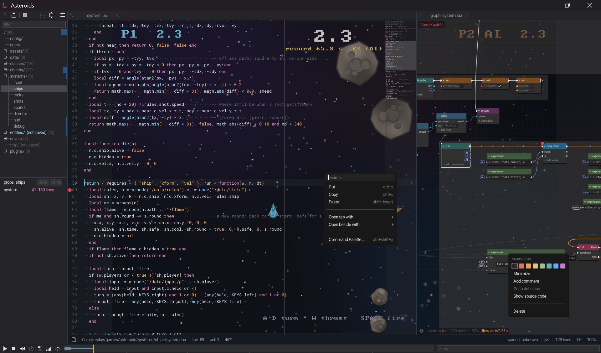
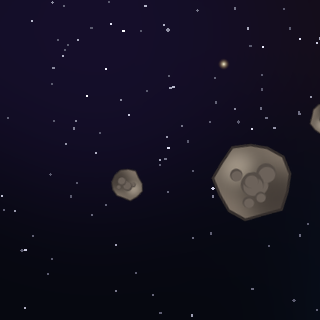
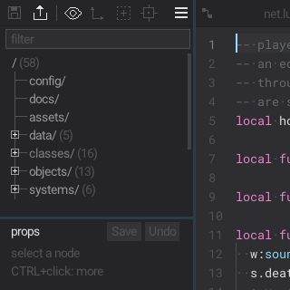
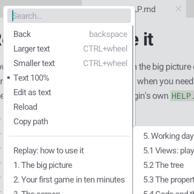
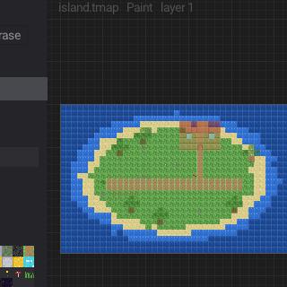
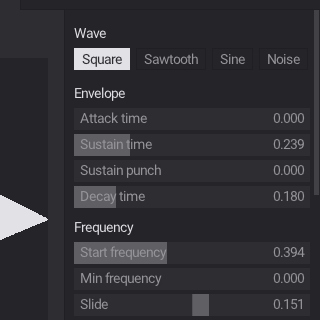
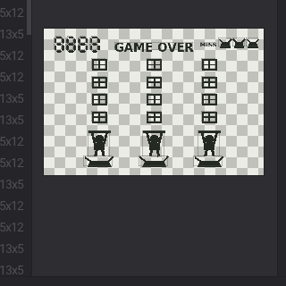
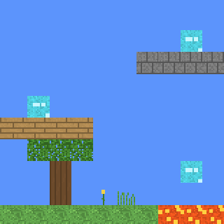

## What is Replay🎮 ?

Replay is a small editor for smaller games, and a place to experiment with ideas and have fun with it.

Edit your game while it runs. Inspect its world as a tree, text or node graph. Rewind to an earlier moment, change something, and play again.

<p align="center">

</p>

## Why Replay?

Most game-development workflows separate the game, the editor, the debugger, and the history of what happened.

Replay tries a different approach: bring them together in one live, editable world described as a tree.

- **Game as a tree.** Every world is made of nodes. Find things by paths or patterns, inspect their values, and navigate relationships directly.
- **Code as data.** The tree node can be serialized, diffed, patched, snapshotted, and used as a basis for undo and replication. Node leaves hold data or Lua code; folders organize them.
- **Change things live.** Edit code, systems, and world data without restarting the game; even if a script fails to compile.
- **Rewind and experiment.** Scrub through time, inspect previous states, slow things down, and continue from an earlier moment.
- **Treat history as data.** Save, compare, diff, and patch parts of the world. Systems and scripts participate in the same model.
- **Both code and graphs.** Source files are the ground truth; the node graph is another way to visualize and edit it.
- **Multiplayer locally.** Simulate network latency and packet loss to investigate how games behave under imperfect conditions.

The idea is simple: spend less time restarting and guessing—and more time iterating and experimenting.

## Why Lua?

Replay supports LuaJIT and Lua 5.4, which is a small, embeddable, and easy-to-reload scripting language. It can be interpreted or JIT'ed. It makes a good fit for a tool built around short feedback loops and live experimentation.

If you prefer languages with braces, Hurdy is also supported. And other [languages that compile to Lua](https://github.com/hengestone/lua-languages) could be supported in the future as well.

The goal isn't to build the fastest or biggest engine. It's to make a compact environment where ideas are fun and quick to implement.

## What's inside?

### A live game editor
- Embedded code editor, world tree, properties, and log.
- Edit game code and data while the world is running.
- Hot reload with recovery from script compilation errors.
- Timeline scrubbing, rewind, slow motion, and replay.

### A dual text/node-graph environment
- Visualize and edit asset files through text or node graphs.
- Inspect values on hovered text or wires, and follow references.
- Work with functions, comments, definitions, and graph navigation.
- Debug with breakpoints and stepping in code and graphs.
- Lua 5.4 or LuaJIT, with support for Hurdy scripts.

### A world you can inspect
- Address nodes by path and select them by pattern.
- Save and load subtrees as Lua data.
- Diff and patch changes.
- Inspect and rewind game state over time.

### Tools and plugins for experimentation
- Debug drawing, input inspection, and profiling.
- Plugin-based editor that can host additional tools, including graph, tilemap, particle, audio, and asset workflows.
- See [PLUGINS.md](PLUGINS.md) for a detailed description.

### Multiplayer and networking
- Replay's design includes multiplayer simulation, per-player state, and network replication concepts.
- Simulated network conditions for daily multiplayer testing, rather than after deployment.
- See [NETWORK.md](NETWORK.md) for the networking design and implementation details.

Some capabilities are still evolving. See the [FEATURES.md](FEATURES.md) and [ROADMAP.md](ROADMAP.md) documents for extra details.

## Get started

### Requirements

Replay uses SDL3 3.2 or newer.

- **macOS:** install SDL3 with Homebrew: `brew install sdl3`.
- **Windows:** install Visual Studio for game development, or install MinGW/MSYS2/Cygwin.
- **Linux:** install your distribution's SDL3 development package, such as `libsdl3-dev`, or point the build to your SDL3 installation (`make SDL_DIR=/path/to/sdl3`).

### Build

On Linux and macOS, Windows with MinGW/MSYS2/Cygwin, or from a Visual Studio console prompt:

```sh
make
```

For an optimized build:

```sh
make release
```

To clean up folders and files:

```sh
make tidy
```

### Run a game

Run the project launcher:

```sh
replay
```

Or a specific game from the repository root:

```sh
replay games/pong.lua
```

To start with the authored world stopped:

```sh
replay --stopped games/pong.lua
```

To show frame timings in the window title:

```sh
replay --prof games/pong.lua
```

Check [CMDLINE.md](CMDLINE.md) for a detailed view of available options.

## How to make a game

The best way to understand Replay is to open one of the included games and start changing it.

1. Choose an example from `games/`.
2. Open it in Replay and explore its world tree.
3. Find a system or value that affects the game.
4. Change it while the game is running.
5. Rewind, compare states, and experiment.

Start with [HELP.md](HELP.md) for the walkthrough, then consult [FEATURES.md](FEATURES.md) for a deeper reference.

## Status

Replay is an experimental project for small-game development and engine enthusiasts. No big promises. Just a different way to make games, and a tool to keep exploring.

Its architecture and workflow are ambitious, and cross-platform behavior and individual features may need more testing. Start with the included examples, consult the documentation, and report reproducible problems or suggestions through [GitHub issues](https://github.com/r-lyeh/replay/issues).

## License

Replay is redistributed under four μLicense, Unlicense, 0-BSD, and MIT No Attribution licensing options at your discretion. Third-party dependencies retain their [respective licenses](LICENSES.md).

## Links

- [Lua in 100 seconds](https://www.youtube.com/watch?v=jUuqBZwwkQw), a fast intro to [Lua](https://www.lua.org/). See also: [LuaJIT](https://luajit.org/), [Lite](https://github.com/rxi/lite "the editor inside the editor") and [SDL3](https://github.com/libsdl-org/SDL "windows, input and rendering").
- [Claude](https://claude.ai), the 100x programmer under my technical command.
- [HELP.md](HELP.md), how to make a game with Replay.
- [FEATURES.md](FEATURES.md), everything in detail.
- [ISSUES.md](ISSUES.md), let's discuss.

---

<h2 align="center"><a href="#">made with &lt;replay&gt; 🎮</a></h2><br/>
<p align="center">



<br/>



<br/>



<br/>
</p>
